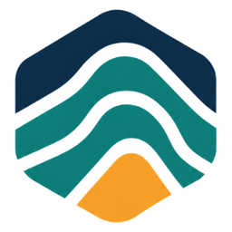
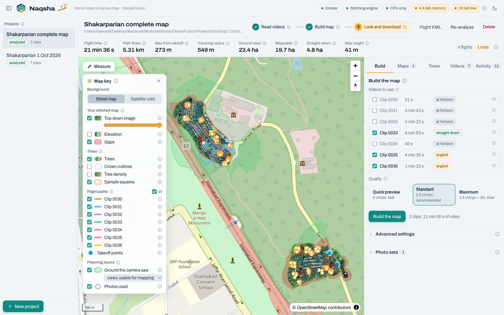
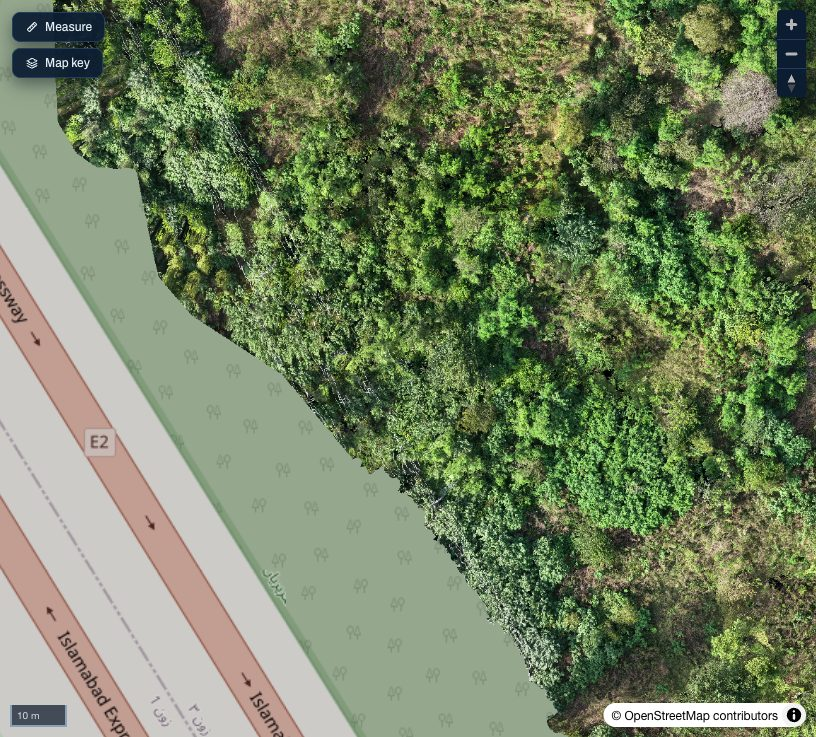
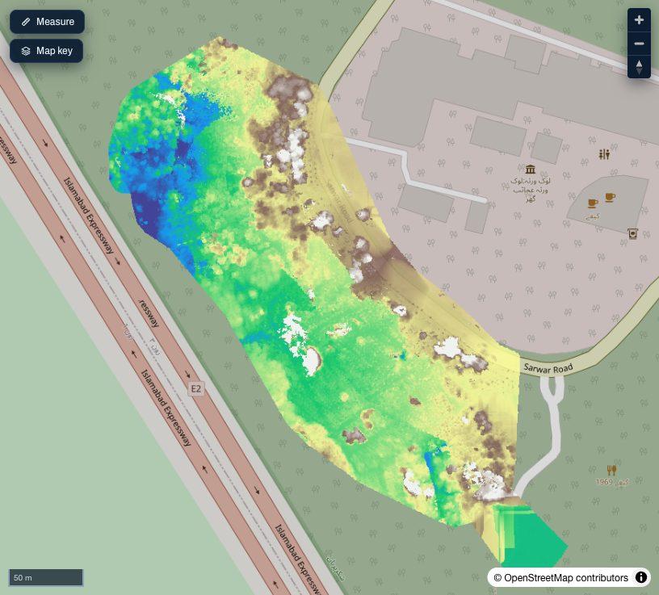
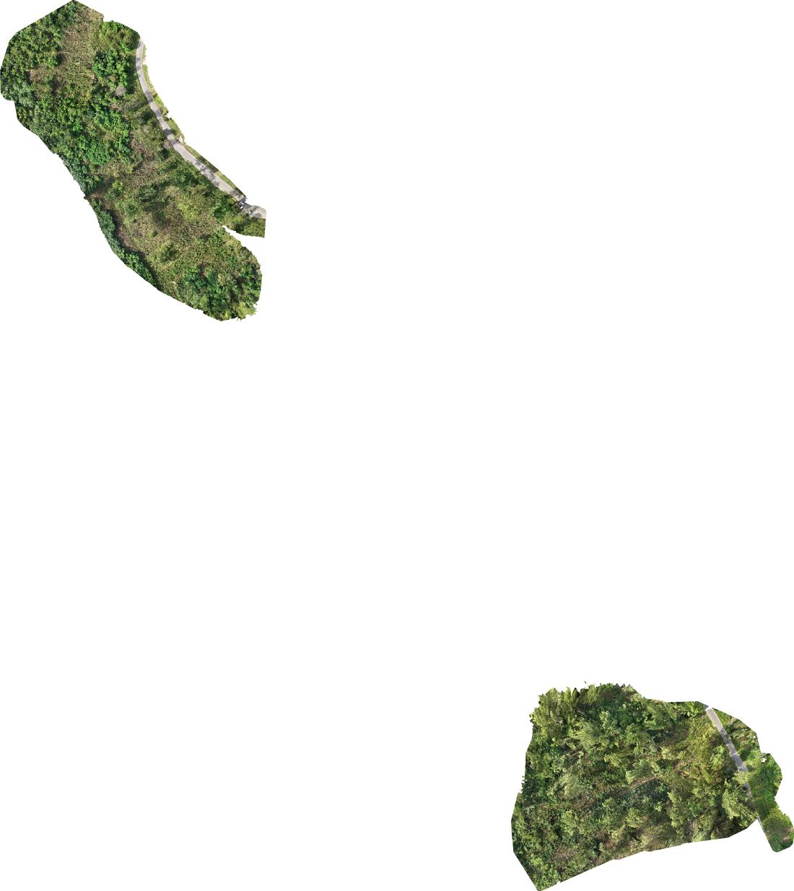
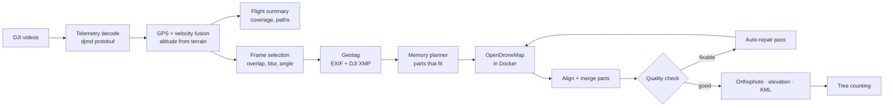
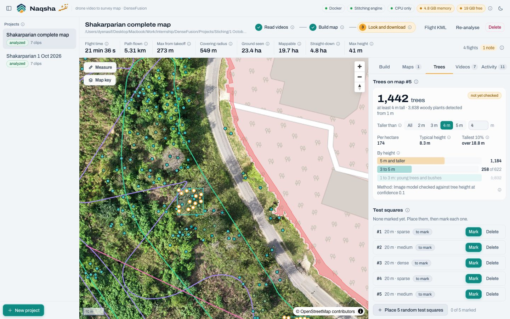
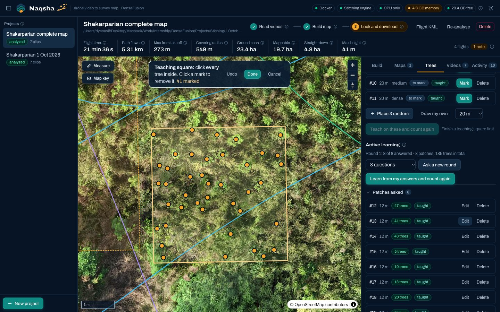

<div align="center">

<picture>
  <source media="(prefers-color-scheme: dark)" srcset="docs/images/logo-dark.png">
  
</picture>

# Naqsha &nbsp;<sub>نقشہ</sub>

**Drone video in, survey map out.**<br>
A local platform that turns ordinary DJI videos into a georeferenced orthophoto, an elevation model,
an exact record of the flight, and a tree count with its accuracy measured by hand.


[Quick start](#quick-start) · [How it works](#how-it-works) · [Tree counting](#tree-counting) ·
[Accuracy](#what-it-does-about-accuracy) · [8 GB laptops](#how-it-fits-on-an-8-gb-laptop) · [Layout](#project-layout)

**[User Guide (PDF)](docs/pdf/Naqsha-User-Guide.pdf)** · **[Technical Overview (PDF)](docs/pdf/Naqsha-Technical-Overview.pdf)**

</div>

<br>

<picture>
  <source media="(prefers-color-scheme: dark)" srcset="docs/images/hero-dark.jpg">
  
</picture>

<br>

## Why

Recent satellite imagery of a site is often years old or simply not available. A consumer drone
already records everything needed for a fresh map: 4K video, and inside every MP4 a per-frame
GPS, height and camera-angle track. Naqsha reads that track, picks the right frames, stitches them
with OpenDroneMap, checks the result and repairs it, without anyone having to sit with it.

<table>
<tr>
<td width="50%"></td>
<td width="50%"></td>
</tr>
<tr>
<td align="center"><sub>The stitched map at 2.5 cm per pixel</sub></td>
<td align="center"><sub>Elevation model: trees stand out from the ground</sub></td>
</tr>
</table>

## Highlights

- **Reads the flight from the video itself.** DJI's embedded `djmd` telemetry is decoded frame by
  frame, GPS jumps are smoothed with the drone's own velocity, and altitude is rebuilt from a
  terrain model so batteries that disagree by 44 m still line up.
- **Picks photos like a surveyor would.** Frames are chosen by real ground-footprint overlap,
  sharpness, camera angle and turn rate, and every neighbouring pair is checked by feature matching
  before stitching starts.
- **Stitches on an 8 GB laptop.** A learned memory model splits big surveys into parts that fit,
  retries any part that runs out of memory, then aligns and merges them into one map.
- **Checks its own work.** Photos that land far from their GPS, maps that break into pieces and
  gaps in coverage are found automatically; one repair pass fixes what it can.
- **Counts trees, honestly.** A deep learning crown detector, a canopy height model, a height
  filter, random test squares for grading, and active learning for teaching.
- **One screen, explained.** Map-first interface with plain-language help on every control, light
  and dark themes, and a command line that does the whole job unattended.

## Results on the Shakarparian survey

The first site: 7 clips of 4K60 video from a DJI Mini 5 Pro over Shakarparian, Islamabad.

| | |
|---|---|
| Photos used | **849 / 849** fitted into one model |
| Map | **8.3 ha** at **2.5 cm per pixel**, plus elevation model |
| Fit | reprojection **0.99 px**; position vs GPS **0.4 m** median, 2.4 m at the 95th percentile |
| Built | unattended on an 8 GB M2 MacBook in 21 memory-planned parts, grade *good* |
| Trees | **1,442 at least 4 m tall** (3,638 woody plants from 1 m), model taught on 213 marked trees |



## Quick start

```bash
./run.sh                                   # web app on http://127.0.0.1:8765
./run.sh process "/path/to/video folder"   # unattended: videos in, finished map out
         [--quality preview|standard|max] [--out DIR] [--trees [--tree-min-height 4]]
```

**Needs** Python 3.11+, Node 20+, ffmpeg and Docker Desktop. The first stitch pulls
`opendronemap/odm` (about 2 GB); the first tree count downloads the DeepForest weights once, then
everything runs offline. Videos are read in place, never copied; working data lives in
`../naqsha-data/` (override with `NAQSHA_DATA`).

Unattended mode reads every video, keeps the clips whose camera points down enough to map, picks
photos, stitches in memory-sized parts, checks and repairs, and writes `map.tif`, `elevation.tif`,
`ground.tif`, `flight.kml`, `coverage.geojson`, `quality.json` and, with `--trees`, the tree files to
`<folder>/naqsha-output/`.

**GPU machine.** On Linux with an NVIDIA card and `nvidia-container-toolkit`, the same `./run.sh`
detects the GPU and uses `opendronemap/odm:gpu` with `--gpus all`. Use `HOST=0.0.0.0 ./run.sh` to
reach it from another computer.

**Tests:** `cd backend && .venv/bin/python -m pytest -q tests`

## How it works



| Layer | Technology |
|---|---|
| Video and telemetry | ffmpeg / ffprobe (VideoToolbox on Mac, CUDA on Linux), own protobuf decoder for DJI `djmd` and `.SRT` |
| Geometry | NumPy, OpenCV (SIFT, FLANN, MAGSAC), Shapely, pyproj, Copernicus GLO-30 terrain |
| Photogrammetry | OpenDroneMap 3.6 (OpenSfM, OpenMVS) in Docker, with an orientation fix mounted at run time |
| Rasters and tiles | GDAL, rasterio, rio-tiler on Cloud-Optimised GeoTIFFs |
| Trees | DeepForest 2.1 (PyTorch, RetinaNet), SMRF ground filter, own active-learning loop |
| Backend | FastAPI, SQLite job queue (WAL, atomic claim), one background worker |
| Frontend | React 19, TypeScript, Vite, Tailwind CSS 4, MapLibre GL 6, Archivo and Noto Nastaliq Urdu |

## Tree counting

<picture>
  <source media="(prefers-color-scheme: dark)" srcset="docs/images/trees-dark.jpg">
  
</picture>

Trees tab, or `./run.sh process DIR --trees --tree-min-height 4`. Works on any finished Standard or
Maximum map.

1. **Tree heights.** Bare ground is separated from trees with SMRF (Pingel et al. 2013, the filter
   ODM and PDAL use) on the DSM's minimum surface; canopy height is the DSM minus the ground.
2. **Crowns in the image.** DeepForest 2.1 (Weinstein et al. 2019). The pretrained model runs at
   10 cm per pixel; models taught on a site run at **5 cm**, because a 1 m sapling is about 10
   pixels at 10 cm, below the detector's smallest anchor. Boxes on roads and roofs fail a
   vegetation colour test.
3. **Three methods, no hidden rules.** Image only; image checked against height (split boxes that
   hold two treetops, add tall treetops the image missed); height only. The best is chosen by F1
   against hand-marked squares.
4. **Height filter.** Everything woody from 1 m is detected; *Taller than X m* decides what is
   counted, drawn and exported, and is saved per map.
5. **Test squares grade, teaching squares teach.** Test squares are placed at random, stratified by
   crown density, and are never used for training. Their hand counts give precision, recall and a
   corrected total with a 95% range.
6. **Active learning.** *Ask me* places small patches where the model is least sure (confidence at
   the cut-off, image and height disagreeing) and walks through them one by one. Whole patches are
   marked rather than single boxes, so no unlabelled tree is taught as background; an empty patch
   teaches what is not a tree.
7. **Cumulative and per site.** Every teaching run retrains from the site's starting point on all
   squares and answers marked so far, so random squares and active learning feed one model. New
   projects start from plain DeepForest unless told to start from another site's model.



**Measured on unseen sapling patches** (61 young trees, never used for training):

| Model | F1 |
|---|---|
| Pretrained, 10 cm | 0.23 |
| Pretrained, 5 cm | 0.49 |
| Taught on 124 site trees, 5 cm | **0.62** (precision 0.91) |

Every labelling session, teaching run and test score is written to `trees/experiment.jsonl`, so
approaches can be compared by the effort they took.

## What it does about accuracy

| Problem | Handling |
|---|---|
| GPS in the videos | DJI's embedded `djmd` protobuf track is decoded per frame (one record per video frame, exact). Older DJI `.SRT` sidecars are also read. |
| GPS jumps (up to 21 m in this footage) | Position = velocity dead-reckoning (cm-precise locally) anchored to a 20 s robust median of GPS. Frames near a jump get a wider position prior so the images are trusted there. |
| GPS latency | Estimated per clip against velocity; applied only when it clearly helps. |
| Absolute altitude off by 44 m between batteries | Rebuilt as terrain height at takeoff plus barometric height. Copernicus GLO-30 is fetched once per project (`NAQSHA_DEM_AUTO=0` stays offline). |
| Gimbal yaw with an arbitrary per-flight offset | Camera heading taken from aircraft yaw, verified against the GPS course (under 1°). |
| Footage not straight down | Per-frame gimbal pitch: 60° or more down are mapping frames, 30 to 60° optional, anything flatter rejected. Footprints use the real camera angle. |
| Motion blur, bad exposure, fast turns | Sharpness relative to the local scene, brightness bounds, a yaw-rate limit for rolling-shutter skew. |
| Too many or too few frames | Picked by actual footprint overlap (85% by default), sharpest frame in each window. |
| Repetitive texture (canopy, grass) | Each consecutive pair is feature-matched and its image motion compared with the GPS/IMU motion; weak or inconsistent links get extra frames. Photos that land far from their GPS after stitching are removed by the repair pass. |
| Other DJI drones | Telemetry fields are only trusted if they behave correctly (heading must follow the GPS course); otherwise the layout is inferred from the data itself. |
| OpenDroneMap orientation bug | ODM 3.6 converts yaw-pitch-roll to omega-phi-kappa through Earth-centred axes, turning every heading prior by 90° plus longitude (163° here) and collapsing the reconstruction (346 points instead of 92k). Naqsha mounts a corrected copy of ODM's `photo.py`, verifies it by running ODM's own code, and falls back to solving around the bug if needed. Fix submitted upstream as [OpenDroneMap/ODM#2078](https://github.com/OpenDroneMap/ODM/pull/2078). |
| Rolling shutter | Enabled, with the readout time taken from the frame rate. |
| Unknown lens in video mode | Starts from the 35 mm-equivalent focal length; the first good self-calibration is stored and reused. |
| Gaps in the map | Planned coverage minus the orthophoto footprint, shown in red. |

Without ground control points, absolute position is consumer-GNSS grade, typically 2 to 5 m.
Relative geometry inside the map is far better. For survey-grade accuracy add GCPs (ODM `--gcp`).

## How it fits on an 8 GB laptop

ODM's own guidance is roughly 4 GB for 40 images and 16 GB for 250, so a whole survey never fits in
one go on a laptop. Naqsha plans around the memory Docker actually has:

1. **Budget.** Docker's memory minus headroom, capped at host RAM minus 3 GB so macOS stays responsive.
2. **Learned memory model** per quality preset: `peak = base + slope × images`, fitted as an upper
   envelope over every finished run. It starts conservative and improves with each run.
3. **Spatial parts.** Frames are split by recursive bisection along the flight's main axis into
   compact parts that fit, each grown by a 15 to 40 m overlap band.
4. **Self-healing.** A part that still runs out of memory, or takes Docker down, is split in two and
   retried (Docker Desktop restarts automatically on macOS), and the model learns from it.
5. **Joining.** Shared photos give each part's offset; a least-squares solve aligns all parts, then
   ODM's own blend-merge produces one orthophoto and one elevation model.
6. **Disk.** Finished parts keep only what merging, checking and resuming need, so a 21-part map fits
   on a laptop disk.
7. **Resume.** Every finished part carries a marker; a retry or repair reuses every unchanged part.

## Project layout

```
backend/naqsha/
  telemetry/     protobuf decoder, DJI djmd + SRT parsers, layout inference
  analysis.py    GPS fusion, altitude harmonisation, flight statistics
  coverage.py    camera footprints, coverage unions, GeoJSON / KML
  selection.py   frame scoring and selection, link check, densification
  geotag.py      EXIF + DJI XMP writer
  odm.py         presets, Docker runner, GPU detection, progress
  odm_compat.py  orientation-bug probe and fix
  memory.py      learned memory model;   chunking.py  parts, alignment
  qa.py          registration, outlier and gap checks, repair plan
  canopy.py      bare ground (SMRF) and canopy height
  trees.py       crown detection, methods, accuracy, active learning, fine-tuning
  treework.py    tree jobs, squares, model versions, experiment log
  pipeline.py    job handlers;   api.py  HTTP API;   tiles.py  COG tile server
frontend/src/    React + MapLibre interface
docs/            user guide and technical overview (pdf/ and their generators), README images, fonts
brand/           logo files
```

## Research this builds on

- Weinstein et al. 2019, *Individual tree-crown detection in RGB imagery using semi-supervised deep learning*, Remote Sensing 11(11):1309 (DeepForest)
- Pingel, Clarke, McBride 2013, *An improved simple morphological filter for the terrain classification of airborne LIDAR data*, ISPRS J. 77 (SMRF)
- ODM large datasets and memory guidance: [docs.opendronemap.org/large](https://docs.opendronemap.org/large)
- Real-time mapping from UAV video: [OpenREALM, Kern et al. 2020](https://arxiv.org/abs/2009.10492)
- Keyframe selection by blur, baseline and overlap: [Remote Sensing 2023, 15(8):2127](https://www.mdpi.com/2072-4292/15/8/2127)
- Forest canopy needs high overlap: [Remote Sensing 10(6):912](https://www.mdpi.com/2072-4292/10/6/912)
- Rolling-shutter modelling for consumer drones: [Vautherin et al., ISPRS Annals 2016](https://isprs-annals.copernicus.org/articles/III-3/139/2016/)
- Learned matchers for repetitive UAV imagery: [ISPRS Archives 2025](https://isprs-archives.copernicus.org/articles/XLVIII-2-W11-2025/169/2025/)
- Global SfM: [GLOMAP, ECCV 2024](https://arxiv.org/abs/2407.20219)
- DJI embedded telemetry formats: [ExifTool DJI tags](https://exiftool.org/TagNames/DJI.html)

---

<div align="center">
<sub>Built by <a href="https://github.com/DyneStein">Muhammad Dyen Asif</a> at DenseFusion. All rights reserved.</sub>
</div>
